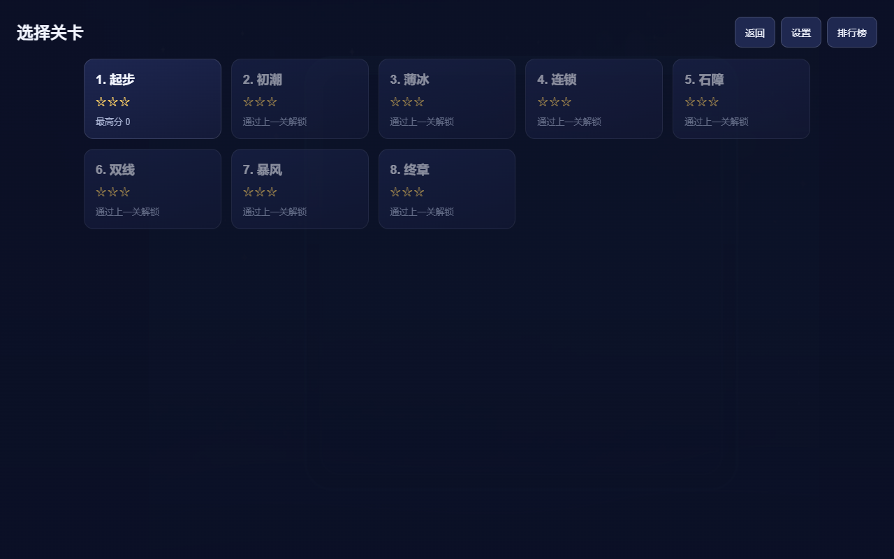
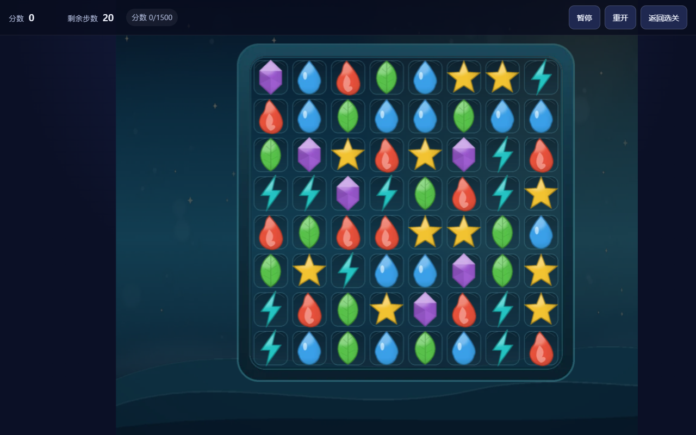

# 三消小游戏 · 8 关

一款可以直接在浏览器中运行的纯前端三消游戏。玩家通过交换相邻元素触发三连及以上的消除，在限定步数内完成分数、收集或破障目标，并逐步解锁 8 个关卡。

项目使用 **TypeScript + Vite + Canvas 2D** 实现，运行时第三方依赖为 0；游戏进度、设置和本地排行榜均保存在浏览器中，不需要账号、后端或网络请求。

<p align="center">
  
  
</p>

## 功能特性

- **完整三消玩法**：8×8 棋盘、相邻交换、横向/纵向三连、下落补充与连锁消除。
- **8 个手工关卡**：分数、元素收集、冰块和石块障碍等多种目标，逐步解锁。
- **特殊元素**：4 连生成直线特化，5 连及以上生成彩虹特化；支持特化连锁触发。
- **确定性随机**：棋盘生成和补充由可注入种子驱动，相同种子与操作序列可以复现相同结果。
- **本地进度**：自动保存解锁进度、最高分、最高星级与设置，损坏存档会备份并安全重置。
- **本地排行榜**：每个关卡最多保留 10 条、全局最多 20 条记录，不采集昵称，不上传数据。
- **桌面与移动输入**：支持鼠标拖拽、触摸滑动及两段式点击操作。
- **可访问性**：提供 `aria-live` 状态播报、色盲符号模式、减弱动效模式和键盘可达按钮。
- **响应式 Canvas**：根据视口等比缩放，DPR 上限为 2，并保持棋盘状态与命中区域同步。
- **音频与降级**：Web Audio 播放 BGM 和音效；资源加载或解码失败时静默降级，不影响继续游戏。
- **自动化测试**：核心规则、渲染、系统、UI 与浏览器端完整流程均有 Vitest/Playwright 覆盖。

## 快速开始

### 环境要求

- Node.js 20 或更高版本
- npm
- 运行 E2E 测试时需要本机安装 Google Chrome

仓库包含 Git LFS 文件。首次拉取时建议先执行：

```bash
git lfs install
git clone https://github.com/jiankai101/sanxiao.git
cd sanxiao
```

### 本地开发

```bash
npm ci
npm run dev
```

打开终端输出的 Vite 开发地址即可开始游戏。

### 生产构建

```bash
npm ci
npm run build
npm run preview
```

构建产物位于 `dist/`。请通过 HTTP 静态服务器访问，不建议直接双击 `dist/index.html`。

### Windows 一键启动

1. 双击 `start-game.cmd`。
2. 脚本会自动检查并构建 `dist/`、选择可用端口、启动本地静态服务并打开浏览器。
3. 默认地址为 `http://127.0.0.1:4173/`；端口被占用时依次尝试 `5173`、`8080`。
4. 游戏结束后双击 `stop-game.cmd` 停止服务。

一键启动使用 Python 3 提供静态服务；如果系统没有 `python`，脚本会尝试 `py -3`。

## 部署

```bash
npm ci
npm run build
```

将 `dist/` 目录发布到任意静态托管服务即可，例如 GitHub Pages、Nginx、对象存储或 CDN。构建使用相对资源路径，支持部署在子目录下，不需要服务端 SPA 回退。

## 玩法说明

| 操作 | 行为 |
|---|---|
| 拖拽相邻元素 | 沿上、下、左、右方向拖动超过半格后交换 |
| 依次点击两个相邻元素 | 交换两个元素 |
| 再次点击已选中元素 | 取消选中 |
| 点击非相邻元素 | 将选中状态转移到新元素 |
| 交换后形成 3 个及以上同类连线 | 消除元素并消耗 1 步 |
| 相邻有效元素交换后无匹配 | 200ms 回弹，不扣步、不加分 |
| 点击棋盘外、石块或死格 | 静默忽略，不改变选中状态 |

### 特殊元素

| 元素 | 生成方式 | 效果 |
|---|---|---|
| 横向直线特化 | 横向 4 连 | 清除所在整行，额外消除元素每个 +30 分 |
| 纵向直线特化 | 纵向 4 连 | 清除所在整列，额外消除元素每个 +30 分 |
| 彩虹特化 | 5 连及以上 | 与普通元素交换时清除全盘该颜色元素 |
| 彩虹 + 彩虹 | 两个彩虹交换 | 清除全盘元素，障碍各减少 1 层 |

### 障碍

| 障碍 | 规则 |
|---|---|
| 冰块 | 元素可正常参与匹配；该格发生消除时冰层 -1，不阻挡下落 |
| 石块 | 不可放置或匹配元素；相邻格消除时层数 -1，破坏前阻挡上方元素下落 |
| 死格 | 永久空格，不可放置、消除或破坏，会阻挡下落 |

## 关卡

| 关卡 | 步数 | 元素数 | 通关目标 | 主要障碍 |
|---|---:|---:|---|---|
| 1 · 起步 | 20 | 6 | 分数 ≥ 1500 | 无 |
| 2 · 初潮 | 22 | 6 | 收集水滴 18 个 | 无 |
| 3 · 薄冰 | 24 | 6 | 破除冰块 18 个 | 冰块 |
| 4 · 连锁 | 24 | 6 | 分数 ≥ 2600 | 无 |
| 5 · 石障 | 26 | 5 | 破除石块 12 个 | 石块 |
| 6 · 双线 | 26 | 5 | 收集火焰 18 个且分数 ≥ 2000 | 冰块 |
| 7 · 暴风 | 28 | 5 | 破除冰块 24 个且石块 6 个 | 冰块、石块 |
| 8 · 终章 | 30 | 5 | 分数 ≥ 3000 且破除石块 10 个 | 石块、死格 |

获得 1 星即可解锁下一关；2 星和 3 星分别要求达到对应分数阈值。

## 开发命令

| 命令 | 说明 |
|---|---|
| `npm run dev` | 启动 Vite 开发服务器 |
| `npm run build` | 类型检查并生成生产构建 |
| `npm run build:test` | 生成带测试钩子的构建 |
| `npm run preview` | 预览生产构建 |
| `npm run typecheck` | 执行 TypeScript 类型检查 |
| `npm test` | 运行 Vitest 单元与集成测试 |
| `npm run test:watch` | 以监听模式运行 Vitest |
| `npm run test:coverage` | 生成 `src/core/**` 覆盖率报告 |
| `npm run test:e2e` | 使用本机 Chrome 运行 Playwright E2E |
| `npm run test:all` | 依次执行类型、单元、构建与 E2E 测试 |

## 技术栈

- **语言**：TypeScript
- **构建**：Vite 6
- **渲染**：Canvas 2D
- **音频**：Web Audio API
- **持久化**：localStorage，带内存降级
- **单元测试**：Vitest + V8 Coverage
- **端到端测试**：Playwright + Google Chrome
- **运行时依赖**：0

## 项目结构

```text
.
├── src/
│   ├── core/                 # 纯规则层：棋盘、交换、匹配、计分、特化、状态机
│   ├── render/               # Canvas 宿主、布局、绘制、动画、粒子和资源加载
│   ├── systems/              # 应用装配、关卡、存档、排行榜、音频、主循环
│   └── ui/                   # HUD、触控/鼠标输入、关卡选择、设置与结算界面
├── assets/                   # 图片、WebP 贴图、BGM、音效和资源清单
├── tests/
│   ├── core/                 # 核心规则测试
│   ├── render/               # 渲染与布局测试
│   ├── systems/              # 存档、排行榜、关卡、音频、补间测试
│   ├── ui/                   # 输入、HUD 与辅助测试
│   └── e2e/                  # 完整浏览器流程与性能测试
├── specs/
│   ├── constitution.md       # 项目约束与工程规则
│   └── 001-core-game/        # 需求规格、技术方案、任务清单
├── docs/                     # 使用说明、性能报告与实现记录
├── coverage/                 # 测试生成，不入库
├── dist/                     # 构建生成，不入库
├── start-game.cmd            # Windows 一键启动脚本
├── stop-game.cmd             # Windows 一键停止脚本
├── playwright.config.ts
├── vite.config.ts
└── package.json
```

### 分层说明

- `src/core` 是纯 TypeScript 规则层，不依赖 DOM、存储、网络或隐式时间。
- `src/render` 负责逻辑坐标、Canvas 缩放、绘制与动画。
- `src/systems` 负责关卡、存档、排行榜、音频和运行时编排。
- `src/ui` 负责输入映射、HUD、菜单和结果面板。
- `tests` 与 `specs` 中的 REQ 编号保持对应，便于从需求追溯到测试。

## 数据与隐私

游戏只使用两个主要本地存储键：

- `wmg.save.v1`：关卡进度、最高分、星级、设置与统计数据。
- `wmg.leaderboard.v1`：本机排行榜记录。

存档损坏时，原始内容会备份到独立键后重置；存储不可用时自动降级为当前会话内存存档。进行中的对局不会在刷新后恢复，但已解锁进度、最高分、星级、设置和排行榜会保留。

## 相关文档

- [玩家使用说明](docs/游戏使用说明.md)
- [需求规格](specs/001-core-game/spec.md)
- [技术方案](specs/001-core-game/plan.md)
- [任务清单](specs/001-core-game/tasks.md)
- [工程约束](specs/constitution.md)
- [性能报告](docs/perf-report.md)
- [系统实现记录](docs/impl-systems-report.md)

## 浏览器支持

推荐使用最新版 Chrome、Edge、Firefox 或 Safari。当前自动化与生产构建验证以 Chrome 为主；Firefox 和 Safari 尚未进行完整 E2E 覆盖。

手机竖屏且视口较窄时，棋盘会整体缩放，单格尺寸偏小。建议横屏或使用平板、桌面设备游玩。
